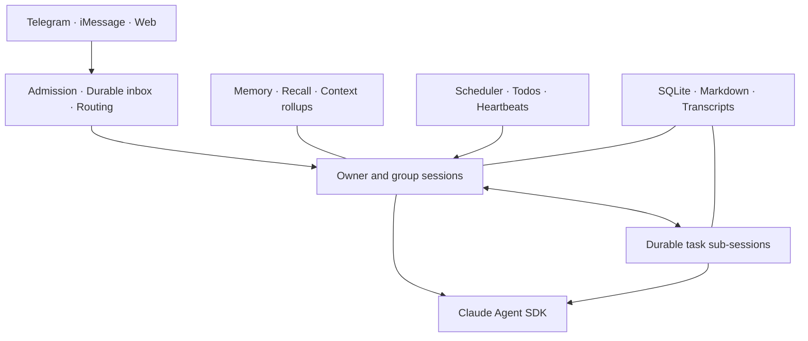

<p align="center">
  <h1 align="center">Tomo</h1>
  <p align="center">An always-on, self-hosted personal AI agent.</p>
</p>

<p align="center">
  <a href="https://www.npmjs.com/package/tomo-ai"></a>
  <a href="https://github.com/shuaiyuan17/tomo/blob/main/LICENSE"></a>
  <a href="https://github.com/shuaiyuan17/tomo/actions/workflows/ci.yml"></a>
</p>

<p align="center">
  Powered by <a href="https://platform.claude.com/docs/en/agent-sdk/overview">Claude Agent SDK</a> &middot;
  Telegram &middot; iMessage &middot; Web
</p>

---

Tomo is a personal AI agent that remembers you, works for you, and stays with you across conversations. It runs on your own machine as a long-running daemon, with one continuous owner conversation across Telegram, iMessage and a private web UI.

Powered by the Claude Agent SDK, Tomo combines the ability to use files, shell, web, skills and MCP with its own personality, memory and sense of time. It can delegate work to independent task sessions, follow up on commitments and run scheduled work while you're away.

## Why Tomo

- **Persistent memory.** Readable, editable Markdown memory with shared and private scopes, source annotations, corrections and daily and weekly memory upkeep. Hierarchical conversation rollups and history search help recover context beyond the active conversation.
- **Durable tasks.** Delegate work to independent sub-sessions that can run concurrently, report progress, ask for input and receive follow-ups, including after a task finishes. Task state persists across daemon restarts.
- **Proactive assistance.** Schedule one-off or recurring work, track commitments with todos, and optionally enable heartbeats for autonomous activity.
- **One conversation, every channel.** Move between iMessage, Telegram and the browser without starting over. Send follow-up messages to steer a running turn.
- **A personality of its own.** Edit `SOUL.md`, `AGENT.md` and `IDENTITY.md` to shape how Tomo behaves.
- **Privacy-aware group chats.** Separate group sessions, scoped memory and permission controls. See the security section for the trust boundaries and limitations.
- **Built for continuous operation.** Durable inbound messages, persisted task state and transactional task-report recording support recovery after interruptions.
- **Yours to extend.** Add MCP servers with managed OAuth, Claude Code plugins and skills, or use LiteLLM for other supported model backends.

## Quick start

```bash
npm install -g tomo-ai
```

```bash
tomo init       # Pick Telegram and/or iMessage, set yourself as the owner, choose a model
```

```bash
tomo start      # Runs in the background
```

That's it — message Tomo on the channel you picked. `tomo init` creates your owner session up front, so a channel you connect later (`tomo config` → Owner / Channels) joins the same conversation.

**Web chat.** The local web UI is on by default at `127.0.0.1:9465`. Get your private access link with:

```bash
cat ~/.tomo/web-access.log
```

### Requirements

- **Node.js 22.16+ or 24+** (Node 23 is not supported; Tomo keeps its runtime state in the built-in `node:sqlite`)
- **A Claude login or an Anthropic API key.** Tomo bundles the Claude Code binary through its Agent SDK dependency, so no separate `claude` install is needed; `tomo init` offers to log in, and `/login` in your DM refreshes it later. [LiteLLM gateways](docs/configuration.md#litellm--chatgpt-subscription-models) support other backends.
- **At least one messaging channel:**
  - **Telegram** — a bot token from [@BotFather](https://t.me/BotFather)
  - **iMessage** — the [imsg CLI](https://github.com/openclaw/imsg) on a Mac signed in to iMessage (Tomo needs Full Disk Access)

## What it can do

Tomo has Claude's built-in tools (Read/Write/Edit, Bash, Glob/Grep, WebSearch/WebFetch, Agent subagents, Skills, TodoWrite, NotebookEdit) plus its own `tomo-internal` MCP server:

| Area | Tools |
|------|-------|
| Messaging | `send_message` (to another chat, verbatim or composed), `list_sessions`, `react_to_message`, `edit_message`, `unsend_message`, `rename_group_chat` |
| Scheduling | `schedule_create` / `schedule_list` / `schedule_enable` / `schedule_remove` — one-shot, interval or cron |
| [Todos](docs/todos.md) | `todo_add` / `todo_list` / `todo_resolve` — commitments with a next step and a review date |
| People | `list_people` / `upsert_person` — the [people registry](docs/channels.md#people-registry) |
| Memory | `memory_list`, `memory_read`, `memory_search`, memory editing tools, `recall_conversation`, `lcm_rollup` |
| Delegation | `task_spawn`, `task_status`, `task_message`, `task_ask`, `task_cancel` |
| Permissions | `request_permission` (a group asks you for a path), `request_credential` (ask you for a password, [opt-in](docs/permissions-and-privacy.md#credential-broker)) |
| Home & pet | `home_check` (its 3D room in the web UI), `pet_*` (a Tamagotchi-style virtual pet; check in with `/pet`) |

The **web UI** adds a live Tasks panel for delegated work and running SDK subagents, the Study (memory, context usage, cost, cron, todos, model, MCP servers, config) and Tomo's home — a low-poly room it designs itself. See [docs/web-ui.md](docs/web-ui.md).

## How it works



Tomo manages the conversation and task lifecycle around the SDK, which provides model execution and tools. The diagram is a conceptual overview, not a call graph.

- **One owner.** Tomo answers DMs only from your own handles. Everyone else gets no reply and no session — admission fails closed.
- **Groups are opt-in.** Send the group passphrase (`tomo config` → Group chats) in a group to activate it. Telegram groups respond when mentioned (or always, with `passiveGroups`); iMessage groups observe and reply only when relevant.
- **Sessions persist.** Conversations resume across restarts; `/new` starts fresh.
- **Local state.** Config, memory, transcripts and logs live under `~/.tomo/`. Model requests and external tools may transmit data to their respective providers. Back up with `tomo backup`.

More: [Channels, sessions and groups](docs/channels.md).

## Security

> [!WARNING]
> **Tomo runs the Claude Agent SDK with permissions bypassed.** In your own DM, the model can do almost anything your user account can: read and write files, run commands, reach the network. Run it on a machine and account you're comfortable giving it, and treat every inbound message, attachment and web page as untrusted input.

- **Group turns are fenced.** `memory/private/` and Tomo's own state (`~/.tomo/data/`) never reach a group. Group Bash runs under a deny-by-default `sandbox-exec` profile; **where that sandbox can't be set up (non-macOS hosts, or a `PreToolUse` hook in workspace settings or a plugin), Bash is withheld on group turns** rather than run unsandboxed. Per-group exceptions and on-demand permission requests: [Permissions and privacy](docs/permissions-and-privacy.md).
- **`unsandboxed: true` for a group is full trust** — that group's shell can read anything you can.
- **The credential broker (off by default) prevents accidents, not a determined model.** See [what it does not stop](SECURITY.md#credential-broker-what-it-does-not-stop).
- **`agentProfiles` scope subagents by policy, not a sandbox.** They stop an agent accidentally deleting a checkout; they don't contain one that wants out. An agent type with no profile is unconstrained. See [per-agent scoping](docs/permissions-and-privacy.md#per-agent-permission-scoping-agentprofiles).
- **The web UI binds to loopback only** and needs the private token in `~/.tomo/web-token`. For remote access use [Tailscale Serve with one exact origin](docs/web-ui.md#private-access-through-tailscale-serve) — never Funnel.
- `config.json` holds channel tokens (and maybe an API key) and is written `0600`.

Trust model and vulnerability reporting: [SECURITY.md](SECURITY.md).

## Everyday use

| CLI | |
|-----|-|
| `tomo status` / `tomo logs -f` | Is it running, and what is it saying? |
| `tomo watch` | Live mission-control TUI (activity feed, vitals, log tail) |
| `tomo config` | Interactive settings: auth, model, LiteLLM, owner, channels, groups |
| `tomo restart` / `tomo stop` | Restart or stop the daemon |
| `tomo update` | Update to the latest version and restart |
| `tomo backup` | Back up all Tomo data (`list`, `restore <date>`) |

| In chat | |
|---------|-|
| `/new` | Start a new conversation |
| `/rewind [N]` | Branch back before your last N messages (DM only) |
| `/model` | Switch model |
| `/status`, `/cost`, `/usage` | Session info, cost, subscription limits |
| `/tasks`, `/todo` | Running tasks; open todos |
| `/summon`, `/dismiss` | (groups) Bring your DM session into a group, and hand it back |
| `/pause`, `/resume` | (groups) Have Tomo ignore a group for a while |

Every command, with details: [docs/commands.md](docs/commands.md).

## Configuration

`tomo config` covers the common settings interactively; everything lives in `~/.tomo/config.json` and most values can be overridden by environment variables. Highlights:

- `model` — default `claude-opus-5-5`; per-chat with `/model`
- `mcpServers`, `plugins` — [extend Tomo](docs/configuration.md#external-mcp-servers) with MCP servers and Claude Code plugins
- `continuity` — [heartbeats](docs/configuration.md#continuity-heartbeats) for autonomous behaviour (off by default)
- `metrics` — Prometheus exporter + activity log, with a [Grafana stack](contrib/observability/README.md)

Full reference: [docs/configuration.md](docs/configuration.md).

## Documentation

| Doc | What's in it |
|-----|--------------|
| [Configuration](docs/configuration.md) | `config.json`, environment variables, MCP servers, plugins, LiteLLM, inbox, steering, observability, files on disk |
| [Commands](docs/commands.md) | Every CLI and chat command, with details |
| [Channels, sessions and groups](docs/channels.md) | Owner session, Telegram, iMessage, group activation, people registry |
| [Permissions and privacy](docs/permissions-and-privacy.md) | Private memory, group sandbox, permission requests, credential broker, `agentProfiles` |
| [Todos](docs/todos.md) | The todo model, its rules and limits |
| [Web UI](docs/web-ui.md) | Web chat, Tasks, the Study, Home, Tailscale access, security |
| [SECURITY.md](SECURITY.md) | Trust model, known limits, reporting a vulnerability |

## Development

```bash
git clone https://github.com/shuaiyuan17/tomo.git && cd tomo
npm install
npm run dev    # Foreground with hot reload
```

See [CONTRIBUTING.md](CONTRIBUTING.md) for checks, conventions and what makes a PR easy to review.

## Contributing

Issues and pull requests welcome at [github.com/shuaiyuan17/tomo](https://github.com/shuaiyuan17/tomo). Please report vulnerabilities privately as described in [SECURITY.md](SECURITY.md).

## License

[MIT](LICENSE)
